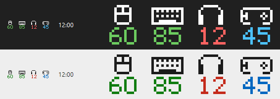
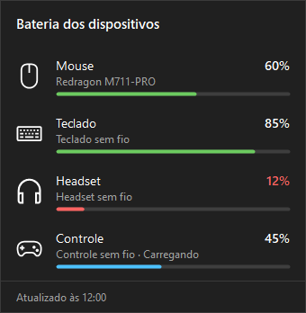
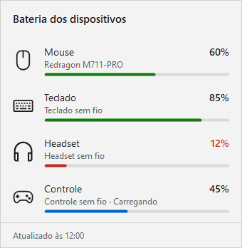

# BatteryTray

**English** · [Português](README.pt-BR.md)

Shows the battery of wireless mice, keyboards, headsets and controllers in the Windows notification area — including the ones Windows does not show on its own (2.4 GHz dongles).

<p>
  
</p>
<p>
  
  
</p>

Each device gets its own tray icon, drawn as pixel art so it stays sharp at 16 px: the device on top and the percentage below — green above 50%, amber up to 50%, red at 20% or less, blue while charging, ✓ when full.

- **Left click:** panel with every device, its percentage and charging state (scrolls when they do not fit on screen).
- **Right click:** Refresh, Start with Windows, Open log, Exit.
- **Low battery warning:** a Windows notification when a device reaches 20%.
- **Instant:** plugging, unplugging or pairing a device updates in ~2 s; battery levels are re-read every minute.
- Follows the taskbar's light/dark theme. Uses about 13 MB of RAM.

## Download

Get `BatteryTray.zip` from the [latest release](https://github.com/eltonmobarbosa/BatteryTray/releases/latest), extract `BatteryTray.exe` to a permanent folder and open it. Nothing to install. A notification confirms it is running and lists what it found. Every release is built by GitHub Actions from this repository's source.

Windows 10 or 11. On Windows 10, drag the icon from the overflow (^) to the taskbar once; Windows remembers it. Windows 11 pins it automatically.

## How the battery is read

There is no universal protocol for 2.4 GHz dongles — each chip speaks its own — so the app tries several readers. None depends on a brand name; when two read the same device, the more specific one wins.

| Reader | Covers | Tested on hardware |
|---|---|---|
| Standard HID | Any brand that reports battery the standard HID way (Battery Strength / Absolute State Of Charge), in feature or input reports | No |
| Bluetooth | Any device whose battery Windows already reads (BLE Battery Service, HFP headsets); connected ones only | No |
| Controllers | Wireless controllers via Windows.Gaming.Input (Xbox and compatible) | No |
| Compx | Compx chip (VID 25A7), used by Redragon and other brands, over the dongle and the cable | Yes (Redragon M711-PRO) |
| Logitech | HID++ 2.0 (Unifying, Lightspeed, Bolt, wired) and HID++ 1.0 (older Unifying) | No |
| Razer | 90-byte protocol documented by OpenRazer | No |
| Fantech | Kanata WG9RD, protocol documented in [peripheral-battery](https://github.com/MarcoVilera/peripheral-battery) | No |
| HeadsetControl | SteelSeries, Corsair, HyperX, Logitech G and other headsets via [HeadsetControl](https://github.com/Sapd/HeadsetControl) (put `headsetcontrol.exe` next to the app or on PATH) | No |

### Your device does not show up?

Run `BatteryTray.exe --diagnose > diagnose.txt` with the device connected and open an issue with the file, the exact model and, if there is one, a link to the manufacturer's software.

## How it was built

**Reverse engineering the Redragon dongle.** The Redragon software ships no protocol documentation, and its debug log is compiled out. So I hooked its HID calls at runtime with [Frida](https://frida.re/) (`HidD_SetFeature`, `DeviceIoControl`, `ReadFile`) while it displayed the battery. Commands turned out to be 17-byte feature reports `0x08` whose bytes sum to `0x55`, answered on input report `0x09`; command `0x04` returns the battery in 10% steps. Checking against the official app at 20% and 30% confirmed the scale, and asking the user to switch the mouse off and plug the cable exposed two traps: the dongle keeps answering with the *last* battery of a mouse that is already off (command `0x03` tells whether it is linked), and on the cable the same mouse shows up with a different USB product id — so the icon is keyed by model, not by id.

**From 68 MB to 13 MB of RAM.** GC settings changed nothing, so I measured publish variants instead: the compressed single-file exe unpacks every assembly into private memory. Shipping it uncompressed inside a zip brought RAM to ~13 MB *and* made the download smaller (50 MB vs 55 MB).

**A readable icon in 16 px.** Tray icons are 16×16 at 100% scale. A number badge over a device glyph was unreadable, and vector glyphs blur at 8 px, so both the devices and the 5×7 digits are hand-drawn pixel art, stacked without overlap and scaled by whole pixels on high-DPI screens.

**Tray icons that Windows remembers.** WinForms' `NotifyIcon` gets a new id every run, so Windows forgot which icons the user had pinned. The app wraps `Shell_NotifyIcon` itself with a GUID derived from the exe path and the device, and re-registers icons whose GUID is still held by a previous instance that was killed.

**A WinRT deadlock.** `--list` hung forever inside the Bluetooth reader. A thread dump (`dotnet-stack`) showed the WinRT call waiting on the main thread; the cause was a WinForms control created in a static initializer, which made WinRT marshal its completion back to that blocked STA thread.

## Development

```powershell
dotnet run                    # tray app
dotnet run -- --list          # readings in the terminal
dotnet run -- --diagnose      # report for adding support for a device
dotnet run -- --preview docs  # regenerates the images above from the real drawing code
```

Build the release exe (no .NET install needed to run it):

```powershell
dotnet publish -c Release -r win-x64 --self-contained -p:PublishSingleFile=true -p:IncludeNativeLibrariesForSelfExtract=true -o publish
```

Do not add `EnableCompressionInSingleFile`: the exe gets smaller but unpacks into RAM (~60 MB instead of ~13 MB).

Publishing a version: `git tag v1.2.3 && git push origin v1.2.3`. The workflow in `.github/workflows/build.yml` builds, runs the self-checks and creates the release with the zip.

### Log

Errors, devices coming and going and battery warnings go to `%LOCALAPPDATA%\BatteryTray\BatteryTray.log` (max ~512 KB, the previous one becomes `.log.old`). Right click → **Open log**.

### Microsoft Defender and SmartScreen

The exe is not code-signed yet, so Windows may show "Unknown publisher" on first run (More info → Run anyway), and "Start with Windows" (which writes to `HKCU\Software\Microsoft\Windows\CurrentVersion\Run`) can trigger a heuristic false positive. Open source projects can request a free certificate from the [SignPath Foundation](https://signpath.org/).

## License

MIT
