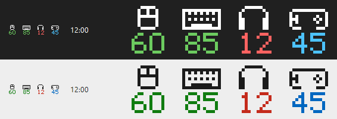
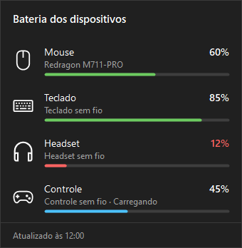
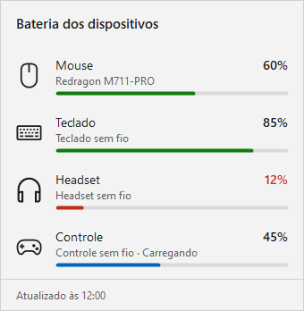

# BatteryTray

[English](README.md) · **Português**

Mostra na área de notificação do Windows a bateria de mouses, teclados, headsets e controles sem fio — inclusive dos que o Windows não mostra sozinho (dongles 2.4 GHz).

<p>
  
</p>
<p>
  
  
</p>

Cada dispositivo ganha o próprio ícone, em pixel art para ficar nítido nos 16 px da bandeja: o dispositivo em cima e a porcentagem embaixo — verde acima de 50%, amarelo até 50%, vermelho em 20% ou menos, azul carregando e ✓ quando cheio.

- **Clique esquerdo:** painel com todos os dispositivos, porcentagem e estado de carga (rola quando não cabem na tela).
- **Clique direito:** Atualizar, Iniciar com o Windows, Abrir log, Sair.
- **Aviso de bateria fraca:** notificação do Windows quando um dispositivo chega a 20%.
- **Na hora:** conectar, desconectar ou parear um dispositivo atualiza em ~2 s; a bateria é relida a cada minuto.
- Segue o tema claro/escuro da barra de tarefas. Usa cerca de 13 MB de RAM.

## Download

Baixe o `BatteryTray.zip` da [última versão](https://github.com/eltonmobarbosa/BatteryTray/releases/latest), extraia o `BatteryTray.exe` numa pasta fixa e abra. Não precisa instalar nada. Uma notificação confirma que está funcionando e mostra o que foi encontrado. Cada versão é compilada pelo GitHub Actions a partir do código deste repositório.

Windows 10 ou 11. No Windows 10, arraste o ícone da setinha (^) para a barra uma vez; o Windows lembra. No Windows 11 ele é fixado automaticamente.

## Como a bateria é lida

Não existe um protocolo universal para dongles 2.4 GHz — cada chip fala de um jeito —, então o app tenta vários leitores. Nenhum depende de marca; quando dois leem o mesmo dispositivo, o mais específico vence.

| Leitor | Cobre | Testado com aparelho |
|---|---|---|
| HID padrão | Qualquer marca que publique a bateria pelo padrão HID (Battery Strength / Absolute State Of Charge), em relatório de feature ou de entrada | Não |
| Bluetooth | Qualquer dispositivo cuja bateria o Windows já lê (BLE Battery Service, headsets HFP); só os conectados | Não |
| Controles | Controles sem fio via Windows.Gaming.Input (Xbox e compatíveis) | Não |
| Compx | Chip Compx (VID 25A7), usado por Redragon e outras marcas, no dongle e no cabo | Sim (Redragon M711-PRO) |
| Logitech | HID++ 2.0 (Unifying, Lightspeed, Bolt e com fio) e HID++ 1.0 (Unifying antigos) | Não |
| Razer | Protocolo de 90 bytes documentado pelo OpenRazer | Não |
| Fantech | Kanata WG9RD, protocolo documentado em [peripheral-battery](https://github.com/MarcoVilera/peripheral-battery) | Não |
| HeadsetControl | Headsets SteelSeries, Corsair, HyperX, Logitech G e outros, via [HeadsetControl](https://github.com/Sapd/HeadsetControl) (a versão 4.2.0 já vem dentro do exe; um `headsetcontrol.exe` ao lado do app ou no PATH tem prioridade) | Não |

### Seu dispositivo não aparece?

Com o dispositivo conectado, rode `.\BatteryTray.exe --diagnose` na pasta do exe (o PowerShell exige o `.\`). Ele salva `diagnose.txt` na Área de Trabalho e abre o arquivo. Abra uma issue com o arquivo, o modelo exato e, se houver, o link do software oficial do fabricante.

## Como foi feito

**Engenharia reversa do dongle Redragon.** O software da Redragon não tem documentação do protocolo e o log de debug foi removido na compilação. Então interceptei as chamadas HID dele em tempo de execução com o [Frida](https://frida.re/) (`HidD_SetFeature`, `DeviceIoControl`, `ReadFile`) enquanto ele mostrava a bateria. Os comandos são relatórios de feature `0x08` de 17 bytes cuja soma dá `0x55`, respondidos no relatório de entrada `0x09`; o comando `0x04` devolve a bateria em passos de 10%. A comparação com o app oficial em 20% e 30% confirmou a escala, e pedir para desligar o mouse e ligar o cabo revelou duas armadilhas: o dongle continua respondendo com a *última* bateria de um mouse já desligado (o comando `0x03` diz se ele está conectado), e no cabo o mesmo mouse aparece com outro product id USB — por isso o ícone é identificado pelo modelo, não pelo id.

**De 68 MB para 13 MB de RAM.** Ajustes de GC não mudaram nada, então medi as variantes de publicação: o exe single-file comprimido descompacta todas as bibliotecas na memória privada. Distribuí-lo sem compressão dentro de um zip levou a RAM a ~13 MB *e* deixou o download menor (50 MB contra 55 MB).

**Um ícone legível em 16 px.** Ícones da bandeja têm 16×16 na escala de 100%. Um selo com o número sobre o desenho do dispositivo ficava ilegível, e glifos vetoriais borram em 8 px; então os dispositivos e os dígitos 5×7 são pixel art desenhada à mão, empilhados sem sobreposição e ampliados em pixels inteiros em telas de DPI alto.

**Ícones que o Windows lembra.** O `NotifyIcon` do WinForms ganha um id novo a cada execução, então o Windows esquecia quais ícones o usuário tinha fixado. O app implementa o próprio `Shell_NotifyIcon` com um GUID derivado do caminho do exe e do dispositivo, e registra de novo ícones cujo GUID ainda está preso a uma instância anterior que foi encerrada à força.

**Um deadlock no WinRT.** O `--list` travava para sempre no leitor Bluetooth. Um dump das threads (`dotnet-stack`) mostrou a chamada WinRT esperando a thread principal; a causa era um controle WinForms criado num inicializador estático, que fazia o WinRT devolver o resultado para essa thread STA bloqueada.

## Desenvolvimento

```powershell
dotnet run                    # app na bandeja
dotnet run -- --list          # leituras no terminal
dotnet run -- --diagnose      # relatório para pedir suporte a um dispositivo
dotnet run -- --preview docs  # gera de novo as imagens acima a partir do código de desenho real
```

Gerar o exe de release (roda sem instalar o .NET):

```powershell
dotnet publish -c Release -r win-x64 --self-contained -p:PublishSingleFile=true -p:IncludeNativeLibrariesForSelfExtract=true -o publish
```

Não use `EnableCompressionInSingleFile`: o exe fica menor, mas descompacta na RAM (~60 MB em vez de ~13 MB).

Publicar uma versão: `git tag v1.2.3 && git push origin v1.2.3`. O workflow `.github/workflows/build.yml` compila, roda os self-checks e cria o Release com o zip.

### Log

Erros, dispositivos que entram/saem e avisos de bateria ficam em `%LOCALAPPDATA%\BatteryTray\BatteryTray.log` (no máximo ~512 KB; o anterior vira `.log.old`). Clique direito → **Abrir log**.

### Microsoft Defender e SmartScreen

O exe ainda não tem assinatura digital, então o Windows pode mostrar "Editor desconhecido" na primeira vez (Mais informações → Executar assim mesmo), e "Iniciar com o Windows" (que grava em `HKCU\Software\Microsoft\Windows\CurrentVersion\Run`) às vezes dispara um falso positivo heurístico. Projetos open source podem pedir certificado gratuito à [SignPath Foundation](https://signpath.org/).

## Licença

MIT

O [HeadsetControl](https://github.com/Sapd/HeadsetControl) 4.2.0 embutido é GPL-3.0, distribuído sem modificações e executado como programa separado; o código-fonte está em https://github.com/Sapd/HeadsetControl/tree/4.2.0.
